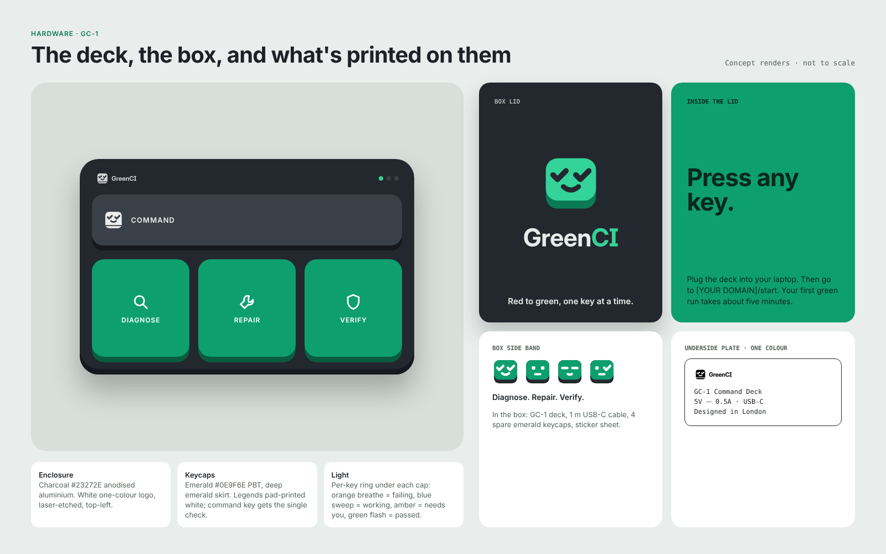
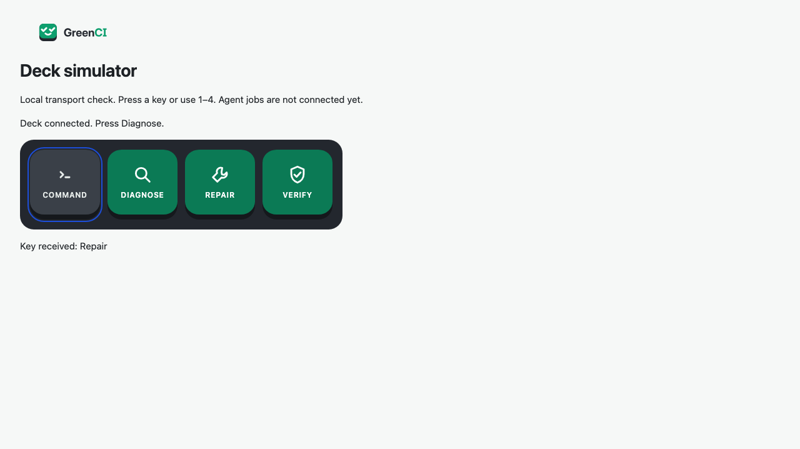
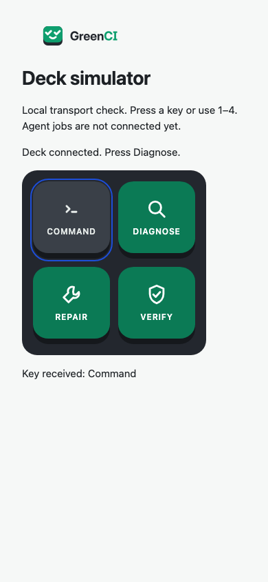

# M0.5 simulator transport check

The simulator is an infrastructure test route, not the hardware concept board or the M5 run-detail deck. The supplied ActionKey reference is the authority for these four controls. It uses the same gc-key/gc-deck classes, the exact line-icon paths from preview.html, and the supplied logo. No supplied design file was changed. Full state lighting and run orchestration follow in M5.

| Supplied hardware concept (context)                | M0.5 transport tester                          |
| -------------------------------------------------- | ---------------------------------------------- |
|  |  |

Inspected desktop/phone rendering and keyboard focus. The controls wrap into two columns on narrow screens without horizontal scrolling. External HTTPS requests were blocked in the browser test to verify font fallbacks. The smaller transport tester does not claim pixel equality with the hardware/package board. Product-page fidelity remains M1/M5.
