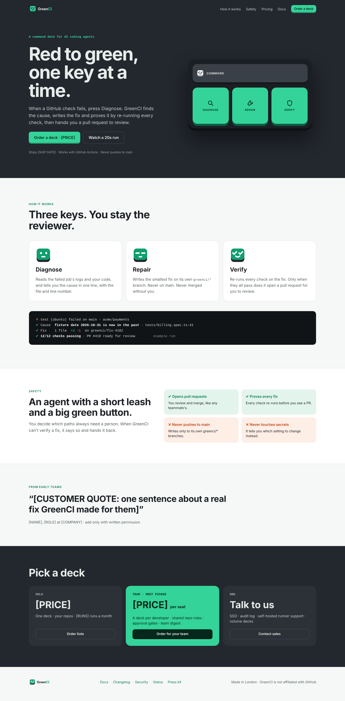
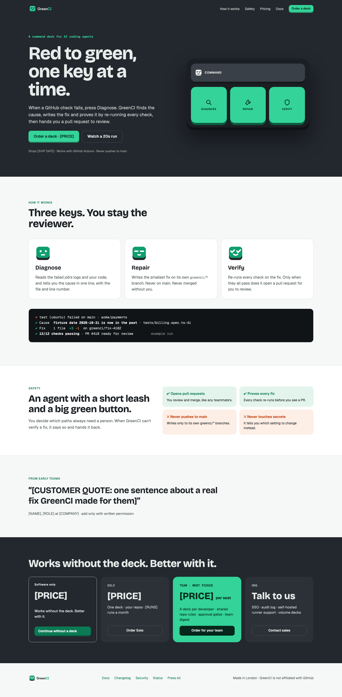

# Landing reference comparison

The landing uses the committed Landing.html markup and original logo/key assets. M4.5 adds the software-only plan inside pricing, the deckless entry and the required “Works without the deck. Better with it.” copy. Prices, ship date, run allowance and customer attribution remain placeholders controlled by packages/core/src/marketing.json.

| Approved reference                             | Current desktop                 |
| ---------------------------------------------- | ------------------------------- |
|  |  |

[Mobile capture](landing-mobile.png) verifies a 390px viewport without page overflow. Desktop is 1440px wide. Fonts are bundled locally and Google font requests are blocked during verification. The remaining product dashboard/onboarding fidelity pass belongs to M5; M4.5 implements their functional deckless entry points.
