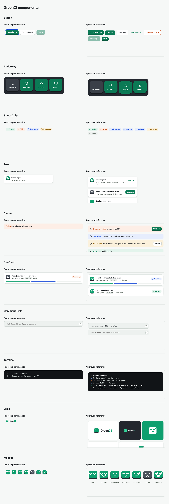
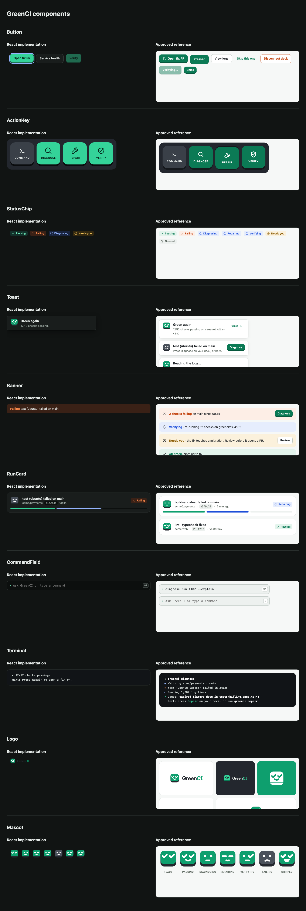

# M1 component comparison

The `/app/_ui` catalogue uses the approved CSS and untouched logo/mood assets. Each React component appears beside its supplied HTML preview. Samples demonstrate the same primitives with different props; this is a component check, not the M5 screen fidelity pass. Fonts were deliberately blocked to verify offline fallback.

| Light                  | Dark                 |
| ---------------------- | -------------------- |
|  |  |

Verified with Playwright: ten reference frames, loaded assets, keyboard focus, disabled controls, both themes and no viewport overflow at 390px. Reference CSS remains byte-identical. Full marketing/product screens remain M5.
